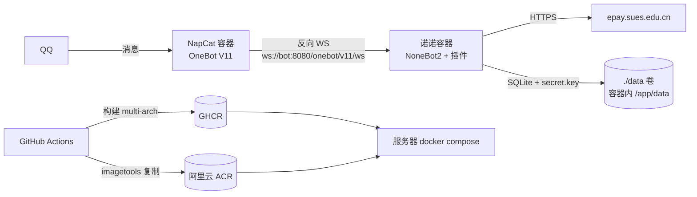

# 诺诺（nuonuo）

基于 [NoneBot2](https://nonebot.dev) 的 QQ 机器人，采用 **nb-cli 标准 `src/` 项目结构**：
`nb run` / `nb plugin install` / `nb plugin create` 都能直接用。

本仓库自带一个插件（`nonebot-plugin-sues-bill`：SUES 电费、耗电历史、校园卡余额），
其余插件你自己装：商店插件走 `nb plugin install`，本地插件放 `src/plugins/`。

## 架构



## 目录结构

```
nuonuo/
├── bot.py                     # 入口：register_adapter + load_from_toml + /healthz
├── src/
│   └── plugins/               # 本地插件目录（nb-cli 约定），空目录即可
├── pyproject.toml             # [tool.nonebot] 声明 adapters / plugins / plugin_dirs
├── uv.lock                    # 依赖锁定（Dockerfile 用 --frozen 复用）
├── Dockerfile                 # 多阶段构建，非 root(10001) 运行
├── docker-compose.yml         # 部署用：只拉镜像；bot + 可选 NapCat sidecar
├── docker-compose.build.yml   # 本地用：给 bot 加 build 段
├── .env.example               # 配置模板
├── .vscode/extensions.json    # 推荐扩展
├── deploy/
│   ├── napcat/onebot11.sample.json   # 反向 WS 配置样例（环境变量失效时用）
│   ├── restore.sh                    # 从旧部署备份恢复插件数据
│   ├── sync-acr.sh                   # 在国内机器把 GHCR 镜像同步到 ACR
│   └── update.sh                     # 服务器更新/回滚（含目录属主修正）
└── .github/workflows/docker.yml      # 双推 GHCR + ACR + 依赖/启动双重冒烟
```

## 快速开始（本地）

```bash
# 1. 安装 nb-cli（一次性）
uv tool install nb-cli

# 2. 装依赖
cp .env.example .env     # 按需改 SUPERUSERS、QQ_BOTS、token
uv sync

# 3. 启动（二选一）
nb run                   # nb-cli 标准方式，自动用项目 venv
uv run python bot.py     # 等价
```

验证：日志出现 `Succeeded to load plugin "nonebot_plugin_sues_bill"`，
群里发 `#电费帮助`（前缀由 `COMMAND_START` 决定）能收到回复。
健康检查：`curl http://127.0.0.1:8080/healthz`。

> `DRIVER` 必须是 `~fastapi+~httpx+~websockets`：QQ 官方适配器需要 HTTP + WebSocket
> 客户端能力，缺了会在启动时报 `need a HTTPClient Driver`。镜像里已内置该默认值。

## 装插件

### 商店插件

```bash
nb plugin install nonebot-plugin-xxx   # 写入 pyproject 的 [tool.nonebot.plugins] 并 uv add
git add pyproject.toml uv.lock
# 推 main → CI 重新构建镜像；插件版本随 image tag 固定
```

### 本地插件

```bash
nb plugin create              # 在 src/plugins 下生成插件骨架
# 或直接把插件目录放进 src/plugins/<name>/
uv add <该插件依赖>            # 依赖写进 pyproject
```

`src/plugins` 会被打进镜像（`COPY src ./src`），容器里不挂载源码，保持镜像不可变；
换插件/升级插件 = 重新构建镜像 + `./deploy/update.sh`。

## 配置说明

| 变量 | 默认值 | 说明 |
| --- | --- | --- |
| `ENVIRONMENT` | `prod` | nonebot 环境名 |
| `DRIVER` | `~fastapi+~httpx+~websockets`（镜像内置） | 必须包含 httpx + websockets |
| `HOST` | `0.0.0.0`（镜像内置） | 必须 `0.0.0.0`，否则 NapCat 连不上而健康检查仍是绿的 |
| `PORT` | `8080` | 改它不必改 compose 映射（映射用 `${PORT}`），NapCat 的 `ONEBOT_URL` 也会跟随 |
| `COMMAND_START` | `["/", "#"]` | 命令前缀；插件回复里的提示会自动跟随 |
| `COMMAND_SEP` | `["."]` | 命令分隔符 |
| `NICKNAME` | `["诺诺"]` | 机器人昵称 |
| `SUPERUSERS` | `[]` | 超管 QQ 号，管理类插件需要 |
| `ONEBOT_ACCESS_TOKEN` | 空 | 与 NapCat 侧 token 一致（不一致会被适配器以 `1008` 断开） |
| `QQ_BOTS` | 空 | QQ 官方机器人 JSON 数组，见下 |
| `SUES_BASE_URL` | `https://epay.sues.edu.cn` | 校园系统地址 |
| `ELECTRICITY_PRICE_PER_KWH` | `0.617` | 电价，用于耗电费用折算 |
| `LOCALSTORE_DATA_DIR` | `/app/data`（镜像内置） | 插件数据目录，与 `./data` 挂载卷对应 |
| `IMAGE` | `ghcr.io/noel-psc/nuonuo:latest` | compose 拉取的镜像地址（**必填**） |
| `BOT_BIND` | `127.0.0.1` | 宿主机端口绑定地址，默认只对本机开放 |

QQ 官方机器人示例（`.env` 里的一行 JSON）：

```dotenv
QQ_BOTS=[{"id":"1020xxxxx","secret":"xxxx","use_websocket":true,"intent":{"at_messages":true,"direct_message":true}}]
```

`use_websocket=true` 走长连接，**不需要公网回调地址**；改成 `false` 则需把
`https://你的域名/qq/webhook` 填到开放平台，并放行到容器 8080。

## 镜像构建

```bash
# 方式一：直接 build（本机单架构）
docker build -t nuonuo:dev .

# 方式二：compose + override，方便本地联调
docker compose -f docker-compose.yml -f docker-compose.build.yml up -d --build

# 多架构构建并直接推送（需先 docker login）
docker buildx build \
  --platform linux/amd64,linux/arm64 \
  -t ghcr.io/noel-psc/nuonuo:latest \
  --push .
```

镜像细节：`python:3.12-slim-bookworm` + uv venv、UID 10001 非 root、内置
`HEALTHCHECK`、`HOST=0.0.0.0`、`DRIVER=...`、`LOCALSTORE_DATA_DIR=/app/data`，只装
`libgomp1`/`tzdata`（onnxruntime 与 `ZoneInfo("Asia/Shanghai")` 需要）。

> ⚠️ 两个构建阶段必须同为 Debian bookworm：换成 alpine 会让 venv 在运行阶段不可用。

## 推送到 GHCR + 阿里云 ACR

### 1. 在 GitHub 仓库配置 Secrets

`Settings → Secrets and variables → Actions → New repository secret`：

| Secret | 示例 | 说明 |
| --- | --- | --- |
| `ACR_REGISTRY` | `registry.cn-hangzhou.aliyuncs.com` | ACR 访问域名；个人版新实例形如 `crpi-xxx.cn-shanghai.personal.cr.aliyuncs.com`。**必须用公网域名，不能用 `-vpc` 域名**（GitHub Actions 在外网）。误写 `https://` 前缀会自动去掉 |
| `ACR_NAMESPACE` | `noel` | ACR 命名空间 |
| `ACR_USERNAME` | `你的阿里云账号` | ACR 登录用户名 |
| `ACR_PASSWORD` | `xxxx` | ACR 固定密码（容器镜像服务→访问凭证） |

> 四个都配齐才会推 ACR；缺任何一个都只推 GHCR，工作流不会失败。

### 2. 触发

推 `main` 或打 tag 即触发 `.github/workflows/docker.yml`：

- `main`：`latest` + `sha-<40位commit>` + `main`
- `v1.2.3`：`1.2.3` + `1.2` + `v1.2.3` + `sha-...`
- PR：只验证构建，不推送；ACR 凭据检查与登录也跳过
- `workflow_dispatch` 手动触发时可指定 `platforms`（ACR 个人版若不支持多架构，填 `linux/amd64`）
- 构建完成后由独立 `acr-sync` job 把 GHCR 的 amd64 镜像复制到 ACR（失败只标黄，不拖红流水线）
- `smoke` job 先做依赖冒烟（`nonebot.load_plugin("nonebot_plugin_sues_bill")`），
  再真起容器探活 `/healthz` 并校验插件加载日志

### 3. 同步到 ACR

CI 里有一个独立的 `acr-sync` job 会自动尝试把镜像复制到 ACR。但要注意：
**GitHub 托管 runner（美国）→ 阿里云上海的公网链路，在百 MB 级上传时会被边缘节点重置**
（`HTTP/2 PROTOCOL_ERROR: received from peer`），实测多次重试都在 8~10 分钟后失败。
所以这个 job 设了 `continue-on-error`：失败只是标黄，不影响 GHCR 产物和冒烟测试。

兜底：在国内笔记本 / ECS 上手动同步（几十秒）：

```bash
export ACR_REGISTRY=crpi-xxx.cn-shanghai.personal.cr.aliyuncs.com
export ACR_NAMESPACE=noel-dev
docker login ghcr.io -u <github用户名>        # 私有包需要 read:packages 的 PAT
docker login "$ACR_REGISTRY" -u <阿里云账号>

./deploy/sync-acr.sh                          # 同步 latest
./deploy/sync-acr.sh latest sha-abc123        # 同步指定 tag
```

根治方案：在 ECS 上装一个 GitHub self-hosted runner，VPC 内直推 ACR 是秒级；
把 `acr-sync` job 的 `runs-on` 改成该 runner 即可。

## 服务器部署

### 首次部署

```bash
mkdir -p /opt/nuonuo && cd /opt/nuonuo

# 取文件：docker-compose.yml、.env.example、deploy/
cp .env.example .env
vi .env    # 改 IMAGE、NAPCAT_WEBUI_TOKEN，按需填 QQ_BOTS / SUPERUSERS

# 数据目录属主（容器内 bot 以 uid 10001 运行）
sudo mkdir -p data && sudo chown -R 10001:10001 data

# 登录镜像仓库（私有镜像必需）
echo "$GHCR_PAT" | docker login ghcr.io -u <github用户名> --password-stdin
# 或：docker login registry.cn-hangzhou.aliyuncs.com -u <阿里云账号>

docker compose up -d                    # 仅机器人
docker compose --profile napcat up -d   # 机器人 + NapCat
docker compose logs -f bot
```

compose 里只有 `image:` 没有 `build:`，所以服务器上拉取失败会**直接报错**，
不会退化成「找不到 Dockerfile」这种误导信息；需要本机构建时用 build override。

### NapCat 首次登录

sidecar 通过两个环境变量自动接好反连，无需手改 JSON：

```yaml
MODE: reverse_ws
ONEBOT_URL: ws://bot:8080/onebot/v11/ws
```

首次启动时若 `/app/napcat/config/onebot11.json` 不存在，容器会按上面的值生成它；
**已存在则不覆盖**（后续请到 WebUI 里改，或删掉该文件重启重新生成）。

```bash
sudo mkdir -p napcat/config napcat/qq napcat/plugins
sudo chown -R 1000:1000 napcat
docker compose --profile napcat up -d
```

1. 看二维码：`docker compose --profile napcat logs -f napcat`
2. 或走 WebUI：`ssh -L 6099:127.0.0.1:6099 <服务器>` 后访问 `http://127.0.0.1:6099`，
   用 `.env` 里的 `NAPCAT_WEBUI_TOKEN` 登录。
   （`WEBUI_TOKEN` 只在 `webui.json` 缺失时初始化，改 token 后需删
   `./napcat/config/webui.json` 或直接在 WebUI 里改。）
3. 扫码登录 QQ 号，容器自动反连，bot 日志出现 `Bot <QQ号> connected` 即成功。
4. 群里发 `#电费帮助` 验证。

> 已有在用的 NapCat/Lagrange 可跳过 sidecar，把它指向
> `ws://<bot 主机>:8080/onebot/v11/ws`（此时把 `BOT_BIND` 改成 `0.0.0.0` 或用内网地址）。
> 已有反连配置、不想用环境变量时，可直接套用 `deploy/napcat/onebot11.sample.json`；
> 其中 `token` 必须与 `.env` 的 `ONEBOT_ACCESS_TOKEN` 完全一致。

### 更新与回滚

```bash
./deploy/update.sh                                              # 拉最新 :latest 并重建
./deploy/update.sh ghcr.io/noel-psc/nuonuo:sha-<commit>         # 固定/回滚到某个 tag
WITH_NAPCAT=1 ./deploy/update.sh                                # 连同 NapCat 一起
```

`update.sh` 会先检查 `.env`、修正 `./data`（及 NapCat 目录）属主，再 pull + up。

### 数据与备份

- 容器内数据目录 `/app/data/nonebot_plugin_sues_bill/`（由
  `LOCALSTORE_DATA_DIR=/app/data` 固定），宿主机对应 `./data/`。
- 备份：`tar czf nuonuo-data-$(date +%F).tar.gz data/`。
- ⚠️ `secret.key` 丢失会导致已保存的加密凭据无法解密，必须一起备份。
- 恢复：停容器 → 解包回 `./data` → `sudo chown -R 10001:10001 data` → 起容器。

### 从旧服务器迁移数据

旧部署的 `data/nonebot_plugin_sues_bill/` 与容器内 `/app/data/nonebot_plugin_sues_bill/`
一一对应（镜像固定 `LOCALSTORE_DATA_DIR=/app/data`），直接拷贝即可：

```bash
# 1. 旧数据传到服务器，例如 /opt/nuonuo/backup/data/nonebot_plugin_sues_bill/
rsync -av 旧机:/srv/bot/nuonuo/data /opt/nuonuo/backup/

# 2. 停服 → 留档 → 恢复 → 修正属主 → 起服
cd /opt/nuonuo
WITH_NAPCAT=1 ./deploy/restore.sh /opt/nuonuo/backup/data
```

脚本等价于：

```bash
docker compose stop bot
cp -a data "data.bak.$(date +%Y%m%d-%H%M%S)"          # 现网数据留一份
cp -a /path/to/backup/data/nonebot_plugin_sues_bill/. data/nonebot_plugin_sues_bill/
sudo chown -R 10001:10001 data                       # 容器内 bot 是 uid 10001
docker compose up -d
```

恢复要点：

- **必须拷 `secret.key`**（44 字节 Fernet key）：丢了它，`campus_accounts.encrypted_password`
  解不开，只能让用户重新 `#设置校园卡账号`。
- 旧 `user_*.json` 是历史遗留：库里 `metadata.legacy_json_imported=1`，不会再导入，可留可删。
- 备份里只有本插件数据。旧部署的其他插件（status / mcqq 等）不在本镜像里——先用
  `nb plugin install` 装回、重建镜像，再把各自 `data/<插件名>/` 拷回。
- 旧 `.env.prod` 不能直接复用：按新 `.env.example` 重填 `SUPERUSERS`、`QQ_BOTS`、
  `ONEBOT_ACCESS_TOKEN`、`NICKNAME`、`COMMAND_START` 等；旧的 `LOCALSTORE_USE_CWD`
  不需要（镜像已固定数据目录）。
- 旧部署若跑的是插件的 git 分支，确认该分支已并入 `1.2.0`；备份库 schema 与 1.2.0
  已核对一致（`metadata.schema_version=1`）。

恢复后验证：

```bash
docker compose logs -f bot      # sues_bill 插件 SUCCESS，且无 migration 报错
docker compose exec bot python -c "import sqlite3;c=sqlite3.connect('/app/data/nonebot_plugin_sues_bill/sues_bill.sqlite3');print({t:c.execute(f'select count(*) from {t}').fetchone()[0] for t in ['bot_users','room_subscriptions','room_snapshots','campus_accounts']})"
```

然后在群里发 `#电费` / `#耗电历史` 验证数据是否回来。

## 常见问题

**Q：`nb plugin install` 没生效 / 镜像里没装新插件**
`nb plugin install` 只改 `pyproject.toml` + `uv.lock`，镜像要重新构建
（推 `main` 触发 CI，或 `docker compose -f docker-compose.yml -f docker-compose.build.yml up -d --build`）。

**Q：启动报 `QQ Adapter need a HTTPClient Driver`**
`DRIVER` 少了 `~httpx`/`~websockets`，用 `~fastapi+~httpx+~websockets`。

**Q：首条消息报 `PermissionError` / 数据重启就没了**
`./data` 宿主机目录属主不对（容器内 uid 10001）：`sudo chown -R 10001:10001 data`。
若属主正确但数据仍丢，检查是否改掉了镜像里的 `LOCALSTORE_DATA_DIR`——localstore
默认写 `$HOME/.local/share/nonebot2`，那样 `./data` 就是空挂载。

**Q：`ImportError: libgomp.so.1` 或 cv2 报错**
`ddddocr` 依赖 onnxruntime/opencv-headless，镜像已装 `libgomp1`。

**Q：`ZoneInfoNotFoundError: Asia/Shanghai`**
运行镜像需带 `tzdata`（默认已装）。

**Q：NapCat 连不上，日志反复重连**
- 确认 URL 是 `ws://bot:8080/onebot/v11/ws`（容器内用服务名 `bot`）。
- 确认 bot 健康：`docker compose ps` 中 bot 为 `healthy`。
- 两边 token 必须一致（或都为空）。
- 检查 uvicorn 启动地址是否为 `0.0.0.0`。

**Q：arm64 服务器能跑吗**
可以，CI 默认构建 `linux/amd64,linux/arm64` 双架构；onnxruntime 有 aarch64 wheel。

**Q：GHCR 镜像是私有的，服务器拉不动**
给 `docker login ghcr.io` 一个 `read:packages` 的 PAT；或把 package 设为 public；
或只从 ACR 拉（推荐国内服务器）。

## 安全提示

- `.env`、`data/`、`napcat/` 均已在 `.gitignore` 中，**不要提交**。
- ACR 密码、QQ AppSecret、NapCat token 只放在 GitHub Secrets 与服务器 `.env`。
- 服务器上 8080/6099 都不建议暴露公网；NapCat WebUI 至少设置 `NAPCAT_WEBUI_TOKEN`。
