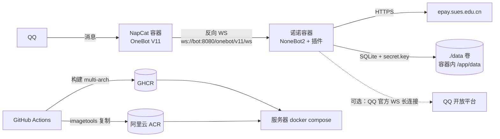

# 诺诺（nuonuo）

基于 [NoneBot2](https://nonebot.dev) 的 QQ 机器人宿主仓库，内置 **SUES 校园账单插件**
（`nonebot-plugin-sues-bill`：电费查询/充值、耗电历史、校园卡余额）。

本仓库只做三件事：**起宿主、装插件、打成 OCI 镜像**。
插件本身独立开发、独立发版（PyPI `nonebot-plugin-sues-bill`），这里以版本约束方式引用。

## 架构



## 目录结构

```
nuonuo/
├── bot.py                     # 宿主入口：init + 适配器开关 + /healthz
├── pyproject.toml             # 依赖 + [tool.nonebot] 插件声明
├── uv.lock                    # 依赖锁定（Dockerfile 用 --frozen 复用）
├── Dockerfile                 # 多阶段构建，非 root(10001) 运行
├── docker-compose.yml         # 部署用：只拉镜像；bot + 可选 NapCat sidecar
├── docker-compose.build.yml   # 本地用：给 bot 加 build 段
├── .env.example               # 配置模板
├── deploy/
│   ├── napcat/onebot11.sample.json   # 反向 WS 配置样例（环境变量失效时用）
│   └── update.sh                     # 服务器更新/回滚（含目录属主修正）
└── .github/workflows/docker.yml      # 双推 GHCR + ACR + 依赖/启动双重冒烟
```

## 快速开始（本地）

```bash
cp .env.example .env          # 按需修改 IMAGE / QQ_BOTS / token
uv sync                       # 安装依赖（含 ddddocr、onnxruntime）
uv run python bot.py          # 启动宿主
```

`bot.py` 会自己解析 `.env` 里的适配器开关（NoneBot 只把 `.env` 读进自己的 Config，
不会注入 `os.environ`），容器里则由 compose `env_file` 注入，环境变量优先级更高。

验证插件已加载：日志里出现 `Succeeded to load plugin "nonebot_plugin_sues_bill"`，
随后在 QQ 群里发 `#电费帮助` 应能收到回复。健康检查：`curl http://127.0.0.1:8080/healthz`。

本地数据默认落在 `~/.local/share/nonebot2/`（localstore 默认行为）；想让数据留在仓库
`./data`，在 `.env` 里设 `LOCALSTORE_USE_CWD=true`。

## 配置说明

| 变量 | 默认值 | 说明 |
| --- | --- | --- |
| `DRIVER` | `~fastapi+~httpx+~websockets` | fastapi 提供服务端（反向 WS）；httpx 供插件出站；websockets 供 QQ 官方适配器 |
| `HOST` | `0.0.0.0`（镜像内置） | 必须是 `0.0.0.0`，否则 NapCat 连不上而健康检查仍是绿的 |
| `PORT` | `8080` | 改它不必改 compose 映射（映射用 `${PORT}`），NapCat 的 `ONEBOT_URL` 也会跟随 |
| `ENABLE_ONEBOT_V11` | `true` | 注册 OneBot V11 适配器 |
| `ENABLE_QQ_OFFICIAL` | `false` | 注册 QQ 官方适配器，可与 OneBot 同时开 |
| `ONEBOT_ACCESS_TOKEN` | 空 | 与 NapCat 侧 token 保持一致（不一致会被适配器以 `1008` 断开） |
| `QQ_BOTS` | 空 | QQ 官方机器人 JSON 数组，见下 |
| `SUES_BASE_URL` | `https://epay.sues.edu.cn` | 校园系统地址 |
| `ELECTRICITY_PRICE_PER_KWH` | `0.617` | 电价，用于耗电费用折算 |
| `LOCALSTORE_DATA_DIR` | `/app/data`（镜像内置） | 插件数据目录，与 `./data` 挂载卷对应 |
| `IMAGE` | `ghcr.io/noel-psc/nuonuo:latest` | compose 拉取的镜像地址（**必填**） |
| `BOT_BIND` | `127.0.0.1` | 宿主机端口绑定地址，默认只对本机开放 |

QQ 官方机器人示例（写进 `.env` 的一行 JSON）：

```dotenv
QQ_BOTS=[{"id":"1020xxxxx","secret":"xxxx","use_websocket":true,"intent":{"at_messages":true,"direct_message":true}}]
```

`use_websocket=true` 走长连接，**不需要公网回调地址**；改成 `false` 则需把
`https://你的域名/qq/webhook` 填到开放平台，并放行到容器 8080。

## 镜像构建

```bash
# 方式一：直接 build（本机单架构）
docker build -t nuonuo:dev .

# 方式二：compose + override，方便本地联调
docker compose -f docker-compose.yml -f docker-compose.build.yml up -d --build

# 多架构构建并直接推送（需先 docker login）
docker buildx build \
  --platform linux/amd64,linux/arm64 \
  -t ghcr.io/noel-psc/nuonuo:latest \
  --push .
```

镜像细节：`python:3.12-slim-bookworm` + uv venv、UID 10001 非 root、内置
`HEALTHCHECK`、`HOST=0.0.0.0`、`LOCALSTORE_DATA_DIR=/app/data`，只装
`libgomp1`/`tzdata`（onnxruntime 与 `ZoneInfo("Asia/Shanghai")` 需要）。

> ⚠️ 两个构建阶段必须同为 Debian bookworm：换成 alpine 会让 venv 在运行阶段不可用。

## 推送到 GHCR + 阿里云 ACR

### 1. 在 GitHub 仓库配置 Secrets

`Settings → Secrets and variables → Actions → New repository secret`：

| Secret | 示例 | 说明 |
| --- | --- | --- |
| `ACR_REGISTRY` | `registry.cn-hangzhou.aliyuncs.com` | ACR 访问域名（误写 `https://` 前缀会自动去掉） |
| `ACR_NAMESPACE` | `noel` | ACR 命名空间 |
| `ACR_USERNAME` | `你的阿里云账号` | ACR 登录用户名 |
| `ACR_PASSWORD` | `xxxx` | ACR 固定密码（容器镜像服务→访问凭证） |

> 四个都配齐才会推 ACR；缺任何一个都只推 GHCR，工作流不会失败。

### 2. 触发

推 `main` 或打 tag 即触发 `.github/workflows/docker.yml`：

- `main`：`latest` + `sha-<40位commit>` + `main`
- `v1.2.3`：`1.2.3` + `1.2` + `v1.2.3` + `sha-...`
- PR：只验证构建，不推送；ACR 凭据检查与登录也跳过
- `workflow_dispatch` 手动触发时可指定 `platforms`（ACR 个人版若不支持多架构，填 `linux/amd64`）
- 构建完成后自动把 GHCR 的 manifest list 原样复制到 ACR（不重复构建）
- `smoke` job 先做依赖冒烟（`nonebot.load_plugin("nonebot_plugin_sues_bill")`），
  再真起容器探活 `/healthz` 并校验插件加载日志

镜像地址（GHCR 与 ACR 的镜像名都取仓库名，避免分叉）：

```
ghcr.io/<owner>/<repo>:latest
<ACR_REGISTRY>/<ACR_NAMESPACE>/<repo>:latest
```

## 服务器部署

### 首次部署

```bash
# 1. 服务器准备目录
mkdir -p /opt/nuonuo && cd /opt/nuonuo

# 2. 取文件：docker-compose.yml、.env.example、deploy/
#    （也可以直接 git clone 本仓库；服务器不需要 Dockerfile）

# 3. 写配置
cp .env.example .env
vi .env    # 改 IMAGE 为真实镜像地址，改 NAPCAT_WEBUI_TOKEN，按需填 QQ_BOTS

# 4. 数据目录属主（容器内 bot 以 uid 10001 运行，否则写不了 SQLite/secret.key）
sudo mkdir -p data && sudo chown -R 10001:10001 data

# 5. 登录镜像仓库（私有镜像必需）
echo "$GHCR_PAT" | docker login ghcr.io -u <github用户名> --password-stdin
# 或：docker login registry.cn-hangzhou.aliyuncs.com -u <阿里云账号>

# 6. 起服务
docker compose up -d                    # 仅机器人
docker compose --profile napcat up -d   # 机器人 + NapCat

# 7. 看状态
docker compose ps
docker compose logs -f bot
```

`docker-compose.yml` 中 bot 的 8080 默认只绑 `127.0.0.1`，NapCat 通过 compose
内部网络用 `ws://bot:8080/onebot/v11/ws` 连入，无需把端口暴露到公网。
compose 里只有 `image:` 没有 `build:`，所以服务器上拉取失败会**直接报错**，
不会退化成「找不到 Dockerfile」这种误导信息；需要本机构建时用 build override。

### NapCat 首次登录

sidecar 通过两个环境变量自动接好反连，无需手改 JSON：

```yaml
MODE: reverse_ws
ONEBOT_URL: ws://bot:8080/onebot/v11/ws
```

首次启动时若 `/app/napcat/config/onebot11.json` 不存在，容器会按上面的值生成它；
**已存在则不覆盖**（后续请到 WebUI 里改，或删掉该文件重启重新生成）。

```bash
# NapCat 以 NAPCAT_UID/NAPCAT_GID（默认 1000）运行，挂载目录需可写
sudo mkdir -p napcat/config napcat/qq napcat/plugins
sudo chown -R 1000:1000 napcat
docker compose --profile napcat up -d
```

1. 看二维码：`docker compose --profile napcat logs -f napcat`
2. 或走 WebUI：容器内 6099 已绑定服务器 `127.0.0.1:6099`，本地
   `ssh -L 6099:127.0.0.1:6099 <服务器>` 后访问 `http://127.0.0.1:6099`，
   用 `.env` 里的 `NAPCAT_WEBUI_TOKEN` 登录。
   （`WEBUI_TOKEN` 只在 `webui.json` 缺失时初始化，改 token 后需删
   `./napcat/config/webui.json` 或直接在 WebUI 里改。）
3. 扫码登录 QQ 号，容器会自动反连到 bot，bot 日志出现
   `Bot <QQ号> connected` 即成功。
4. 群里发 `#电费帮助` 验证。

> 若你已有在用的 NapCat/Lagrange，可跳过 sidecar，把它指向
> `ws://<bot 主机>:8080/onebot/v11/ws` 即可（此时需要把 `BOT_BIND` 改成
> `0.0.0.0` 或用反向代理/内网地址）。已有反连配置、不想用环境变量时，可直接套用
> `deploy/napcat/onebot11.sample.json`；其中 `token` 必须与 `.env` 的
> `ONEBOT_ACCESS_TOKEN` 完全一致，否则适配器会反复以 `1008` 断开重连。

### 更新与回滚

```bash
./deploy/update.sh                                              # 拉最新 :latest 并重建
./deploy/update.sh ghcr.io/noel-psc/nuonuo:sha-<commit>         # 固定/回滚到某个 tag
WITH_NAPCAT=1 ./deploy/update.sh                                # 连同 NapCat 一起
```

`update.sh` 会先检查 `.env`、修正 `./data`（及 NapCat 目录）属主，再 pull + up。

依赖升级（插件新版本）在本地做：`uv lock --upgrade-package nonebot-plugin-sues-bill`，
提交 `pyproject.toml` + `uv.lock` 后由 CI 重新构建镜像。

### 数据与备份

- 容器内数据目录 `/app/data/nonebot_plugin_sues_bill/`（由
  `LOCALSTORE_DATA_DIR=/app/data` 固定），宿主机对应 `./data/`。
- 备份：`tar czf nuonuo-data-$(date +%F).tar.gz data/`。
- ⚠️ `secret.key` 丢失会导致已保存的加密凭据无法解密，必须一起备份。
- 恢复：停容器 → 解包回 `./data` → `sudo chown -R 10001:10001 data` → 起容器。

## 常见问题

**Q：容器起来就退出，日志提示 `未启用任何适配器`**
检查 `.env` 的 `ENABLE_ONEBOT_V11` / `ENABLE_QQ_OFFICIAL` 至少一个为 `true`。

**Q：首条消息报 `PermissionError` / 数据重启就没了**
`./data` 宿主机目录属主不对（容器内是 uid 10001）：`sudo chown -R 10001:10001 data`。
若属主正确但数据仍丢，检查是否有人改掉了镜像里的 `LOCALSTORE_DATA_DIR`——localstore
默认会写 `$HOME/.local/share/nonebot2`，那样 `./data` 就是空挂载。

**Q：`ImportError: libgomp.so.1` 或 cv2 报错**
`ddddocr` 依赖 onnxruntime/opencv-headless，镜像已装 `libgomp1`；若自行改基础镜像，
需补 `libgomp1`。

**Q：`ZoneInfoNotFoundError: Asia/Shanghai`**
运行镜像需带 `tzdata`（默认已装）。

**Q：NapCat 连不上，日志反复重连**
- 确认 URL 是 `ws://bot:8080/onebot/v11/ws`（容器内用服务名 `bot`）。
- 确认 bot 健康：`docker compose ps` 中 bot 为 `healthy`。
- 两边 token 必须一致（或都为空）。
- 检查 bot 是否真的监听 `0.0.0.0`（`docker compose logs bot` 里 uvicorn 的启动地址）。

**Q：`#电费` 报网络/证书错误**
容器内出站 HTTPS 需 `ca-certificates`（默认已装）；确认服务器能访问
`https://epay.sues.edu.cn`。

**Q：arm64 服务器（如华为鲲鹏/树莓派）能跑吗**
可以，CI 默认构建 `linux/amd64,linux/arm64` 双架构；onnxruntime 有 aarch64 wheel。

**Q：GHCR 镜像是私有的，服务器拉不动**
给 `docker login ghcr.io` 一个 `read:packages` 的 PAT；或把 package 设为 public；
或干脆只从 ACR 拉（推荐国内服务器）。

## 安全提示

- `.env`、`data/`、`napcat/` 均已在 `.gitignore` 中，**不要提交**。
- ACR 密码、QQ AppSecret、NapCat token 只放在 GitHub Secrets 与服务器 `.env`。
- 服务器上 8080/6099 都不建议暴露公网；NapCat WebUI 至少设置 `NAPCAT_WEBUI_TOKEN`。
